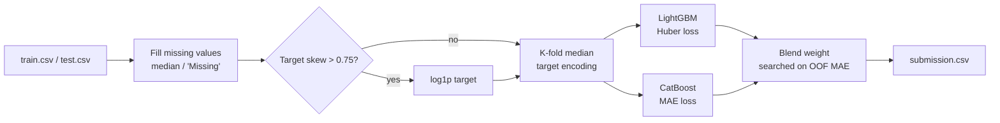

# APPLAI '26 competition: 2nd place

Regression solution that took **2nd place** in the APPLAI '26 competition. It blends a **LightGBM** and a **CatBoost**
model, each tuned with **Optuna** under 5-fold cross-validation, and optimizes everything for mean absolute error (MAE).

## How it works

| Step | What it does |
|---|---|
| **Preprocessing** | Fills numeric columns with the training median and categorical columns with `"Missing"`. |
| **Target transform** | If the target's skew is above 0.75, trains on `log1p(Y)` and converts predictions back with `expm1`. |
| **Target encoding** | Replaces each categorical column with the median target of its category, computed out-of-fold so a row never sees its own target. Test rows get the average of the 5 fold encodings. |
| **Tuning** | 80 Optuna trials per model, each scored by 5-fold out-of-fold MAE with early stopping (200 rounds). |
| **Training** | Retrains both models with their best parameters on each fold (up to 4,000 trees) and averages the 5 fold predictions on the test set. |
| **Blending** | Tries weights from 0 to 1 in steps of 0.01 and keeps the LightGBM/CatBoost mix with the lowest out-of-fold MAE. |

## Repository layout

| Path | Contents |
|---|---|
| [lastt1.py](lastt1.py) | The full pipeline, exported from a Google Colab notebook |

## Running it

The script was exported from Colab and starts with a `!pip install` line, so run it as notebook cells (Colab or
Jupyter), not with `python`.

1. Upload the competition's `train.csv` and `test.csv` to `/content/` (or change the two paths at the top).
   The target column is `Y` and the ID column is `X1`.
2. Run all cells. Tuning runs 160 Optuna trials of 5-fold training, so expect a long run; lower `N_TRIALS` to go faster.
3. The script prints the best MAE of each model, the blend weight and the blended MAE, then writes `submission.csv`.

| Setting | Value |
|---|---|
| `SEED` | 42 |
| `N_SPLITS` | 5 |
| `N_TRIALS` | 80 per model |
| `EARLY_STOPPING` | 200 rounds |

**Dependencies:** `numpy`, `pandas`, `scikit-learn`, `lightgbm`, `catboost`, `optuna`.
